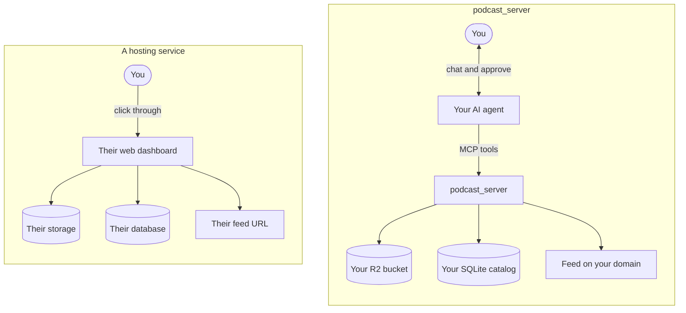
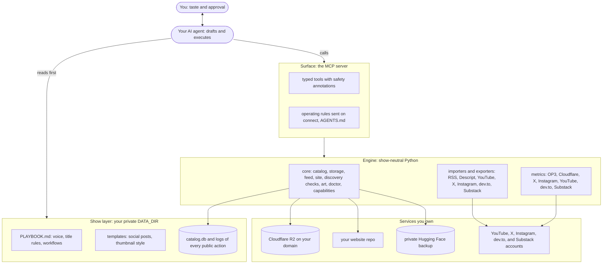
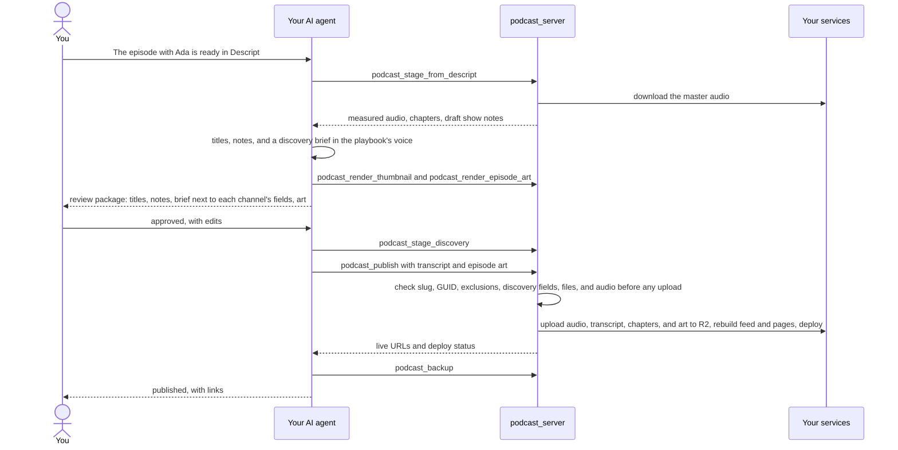
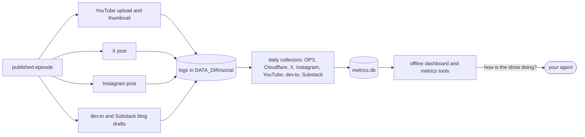

<div align="center">

# podcast_server

**A self-hosted podcast host with no dashboard.**<br>
Your AI agent is the interface. You're the approver.

[](./LICENSE)
[](./pyproject.toml)
[](https://modelcontextprotocol.io)
[](https://gofastmcp.com)
[](https://docs.astral.sh/uv/)
[](https://docs.astral.sh/ruff/)
[](https://developers.cloudflare.com/r2/)
[](https://podcastindex.org/namespace/1.0)

[](https://x.com/DataScienceHarp)
[](https://www.linkedin.com/in/harpreetsahota204)
[](https://www.youtube.com/@datascienceharp)
[](https://employabledatascientist.com)

[What it is](#what-it-is) · [How it works](#how-it-works) · [Quick start](#quick-start) · [MCP tools](#mcp-tools) · [Adopting guide](./ADOPTING.md) · [Agent guide](./AGENTS.md)

</div>

---

## What it is

Podcast hosts charge a monthly fee for three things: storage for the audio, a database of episodes, and an RSS feed, all behind a web dashboard. `podcast_server` keeps those three on infrastructure you own and replaces the dashboard with [MCP](https://modelcontextprotocol.io) tools. The "user interface" is whichever AI agent you already use: Claude, Cursor, Codex, or your own.

You talk to your agent: *"The interview with Ada is ready in Descript. Prep it."* The agent stages the episode, drafts titles and show notes in your show's voice, and stops. You approve. The agent publishes, uploads the video, sets the thumbnail, posts the announcement, drafts copies of the companion blog post on dev.to and Substack (your site stays the original), and tells you a week later how it's doing.



**How to place it:**

| Question | Answer |
| :--- | :--- |
| What job does it do? | Podcast hosting and publishing: storage, feed, catalog, distribution, and analytics |
| Where does it run? | On your machine, against services you own: Cloudflare R2, your domain, and optionally a git-deployed website |
| How do you operate it? | Through an AI agent over MCP. There is no web UI. |
| Who decides? | You. The agent drafts and executes; nothing public happens without your approval. |
| Closest category | A **headless podcast host**: like a headless CMS, where the missing "head" is an agent |

**What it isn't:**

- **Not an editor.** Edit in Descript, or anything that exports an MP3. The engine takes it from there.
- **Not an AI that makes your show.** The engine has no taste, on purpose. Your playbook holds the voice and standards, the agent applies them, and you approve.
- **Not a hosted service.** Nobody runs it for you, and there's no account to sign up for.
- **Not a wrapper around someone else's product.** It *is* the system of record: the catalog, the episode GUIDs, the published audio, and the log of every public action live here.

**New here? Start with [`ADOPTING.md`](./ADOPTING.md)**, a step-by-step guide to running your own show, including migrating from another host without losing subscribers.

---

## How it works

### Three layers, two people



| Layer | Its job | Where it lives |
| :--- | :--- | :--- |
| **Engine** | The hands: does each job correctly and refuses unsafe ones | this repo: `core/`, `importers/`, `exporters/`, `metrics/` |
| **Surface** | The controls: typed tools, safety annotations, operating rules | `mcp_server/server.py`, [`AGENTS.md`](./AGENTS.md) |
| **Show** | The taste and the memory: voice, templates, catalog, logs | your private `DATA_DIR` (template: [`examples/show-data/`](./examples/show-data/)) |

The engine and surface know nothing about any particular show. That's why this repo can be public while your show data stays private, and why one checkout can run several shows (one `.env` each).

### A release, end to end



### After release: promote and measure

Every public action is logged, and metrics only count what the engine itself put out, so numbers are never mixed with the rest of your accounts:



### Safety lives in the engine, not the prompt

An agent can misread a prompt; it can't get past code. The rules that matter are enforced by the engine itself: a database trigger blocks excluded episodes, publishing checks everything before the first upload, uploads never overwrite, and every public action is logged so a retry can't double-post. On top of that, every tool carries [MCP annotations](https://modelcontextprotocol.io/specification/2025-06-18/server/tools#tool-annotations), so your client can run reads freely and ask you before anything public:

| Level | What your client can do | Tools |
| :--- | :--- | :--- |
| Read-only | run without asking | `podcast_status`, `podcast_capabilities`, `podcast_inspect`, `podcast_list_episodes`, `podcast_get_episode`, `podcast_draft_social`, `podcast_metrics_summary`, `podcast_episode_metrics`, and the `podcast_list_*` tools (Instagram, YouTube, dev.to, Substack) |
| Local files | run without asking | `podcast_stage_discovery`, `podcast_stage_thumbnail`, `podcast_render_thumbnail`, `podcast_render_episode_art`, `podcast_render_newsletter_preview`, `podcast_make_gif`, `podcast_metrics_report`, `podcast_create_blog`, `podcast_pull_newsletter` |
| Outside services, additive | run, safe to retry | `podcast_stage_from_descript`, `podcast_rebuild_feed`, `podcast_upload_media_asset`, `podcast_crosspost_to_devto`, `podcast_crosspost_to_substack`, and `podcast_draft_newsletter` (unpublished drafts only), `podcast_unschedule_newsletter`, `podcast_metrics_collect`, `podcast_backup` |
| Public edit | ask you first; safe to retry | `podcast_update_episode`, `podcast_deploy_site`, `podcast_set_youtube_thumbnail`, `podcast_unpublish_devto_article`, and (permanent) `podcast_delete_instagram_post`, `podcast_delete_youtube_video`, `podcast_delete_substack_post` |
| Public release | ask you first; never repeat blindly | `podcast_publish`, `podcast_publish_to_youtube`, `podcast_post_to_x`, `podcast_post_to_instagram`, `podcast_send_newsletter` |

### Design principles

1. **You own the infrastructure.** Audio sits in your bucket, the feed on your domain, the catalog in a file you can open. Leaving means copying files, not exporting from someone's dashboard.
2. **The agent operates; you approve.** Nothing goes public without your explicit approval of the exact content. When a request is unclear, an identifier doesn't match exactly, or a step would bypass a tool, the agent asks instead of guessing, and it says up front what the engine can't do.
3. **Guarantees live in code.** GUIDs are permanent, exclusions are enforced by the database, and checks run before side effects.
4. **Everything is inspectable.** SQLite, Markdown, JSON, and append-only JSONL logs. No hidden state.
5. **The engine is show-neutral.** Your voice, templates, and data live in your own `DATA_DIR`, never in this repo.

---

## Features

- **Feed:** RSS 2.0 + iTunes + Podcasting 2.0 (`<podcast:locked>`, `<podcast:guid>`), exact enclosure byte lengths, Markdown show notes rendered to `content:encoded`, optional OP3 analytics.
- **Two site modes:** `none` serves the feed from your R2 domain, with no website needed. `astro` writes one Markdown page per episode into your site repo and pushes only those files.
- **Migration:** a GUID-preserving importer for any host's RSS feed, with audio mirrored into R2.
- **Agent surface:** MCP tools covering staging (including Descript), publishing, episode edits, deploys, backups, blog posts, social drafts, X and Instagram posts, media uploads, YouTube uploads and thumbnails, and audience metrics. Each tool carries MCP safety annotations (read-only, destructive, idempotent), and the server sends its operating rules to every client on connect, including when to stop and ask the human. `podcast_capabilities` tells the agent which channels are ready right now, and which requests need the human, so it can show you what's possible before planning the work.
- **Discovery at publish time:** each piece of content gets one approved brief (main search phrase, secondary phrases, audience, the question it answers, names people search for), and every publish path checks its own fields against it before anything goes public. That covers the episode title and summary, the blog's meta description, YouTube's title, the first 150 characters of the description, tags, and chapters, alt text and the visible start of an Instagram caption, and alt text on X media. A miss is refused, not warned about. New episodes also carry a transcript (`podcast:transcript`, which Apple displays), a chapters file, and their own artwork in the feed; YouTube uploads get a caption track and a playlist. Applies to content published from now on; nothing already published is changed.
- **Blog cross-posting:** your site keeps the original; the companion blog post goes to dev.to and Substack as unpublished drafts, with site-relative links made absolute. dev.to drafts carry a canonical URL back to your site; Substack has no canonical setting, so its drafts open with an "Originally published at" link. You publish each one on its platform.
- **Instagram posts:** approved images go to your Instagram professional account as feed posts, converted to JPEG and staged on your R2 domain for Meta to fetch. A one-time login saves a never-expiring Page token in its own 0600 file. Carousels, Stories, and Reels are planned.
- **Content management:** agents can list what's on Instagram, YouTube, dev.to, and Substack and remove one item you named at a time: delete an Instagram post, YouTube video, or Substack post or draft (permanent), or unpublish a dev.to article back to draft (dev.to's API can't delete). Each removal checks the item is yours first, has a dry run, and is logged with what was removed.
- **YouTube Shorts:** uploads that are square or vertical and up to 3 minutes become Shorts; with `expect_short`, the engine measures the clip first (ffprobe, rotation-aware) and refuses one that would land as a regular video.
- **YouTube thumbnails and episode art:** your agent renders the art; the engine sets the headline in your show's fonts and colors (auto-fitted, clear of the duration badge, under 2 MB) and pushes it to YouTube after approval. The same art and headline also become the episode's square icon in Apple Podcasts, Spotify, and other apps (2048 px, with your show's wordmark), published with the episode; `REQUIRE_EPISODE_IMAGE=true` makes it mandatory.
- **Audience metrics:** pluggable collectors (OP3 downloads, Cloudflare audio traffic, X, Instagram, and YouTube engagement for the show's own posts and videos, dev.to and Substack reach for the blog posts the engine cross-posted, or your own) feed a local SQLite store, an offline HTML dashboard (an overview plus a tab per platform with every collected number, filtered by range or a stretch you drag across the timeline), and MCP tools agents can query.
- **Safety:** see the list below; checks run before any upload.
- **Backups:** incremental, to a private Hugging Face dataset.

---

## What You Need

`podcast_server` doesn't host anything itself. It drives services you own. The pieces below are what a show needs; each links to its own setup docs, which are the authority for that service (and several have their own MCP server your agent can use for setup).

**Required**

| Piece | What it's for | Get set up |
| :--- | :--- | :--- |
| A domain | Your audio URLs (e.g. `audio.myshow.com`) and feed live on it, so you can change hosts without losing subscribers | Any registrar, e.g. [Cloudflare Registrar](https://www.cloudflare.com/products/registrar/). The domain's DNS must be on Cloudflare for the R2 custom domain ([full setup](https://developers.cloudflare.com/dns/zone-setups/full-setup/)). |
| Cloudflare R2 bucket | Stores the MP3s and serves them (no egress fees, range requests) | [R2 docs](https://developers.cloudflare.com/r2/): create a bucket, an API token with Object Read & Write, and a [custom domain](https://developers.cloudflare.com/r2/buckets/public-buckets/) on it. Cloudflare's [MCP servers](https://developers.cloudflare.com/agents/model-context-protocol/mcp-servers-for-cloudflare/) can help an agent do this. |
| A home for the RSS feed | The URL podcast apps subscribe to | Either nothing extra (`SITE_MODE=none` uploads the feed to your R2 domain) or a git-deployed static site (`SITE_MODE=astro`, e.g. [Astro](https://docs.astro.build) on [Netlify](https://docs.netlify.com)), which also gets one page per episode. |
| Cover art | Required by every directory | Square JPEG/PNG, 1400–3000 px, at a public URL. See [Apple's requirements](https://podcasters.apple.com/support/823-podcast-requirements). |
| Directory listings | How listeners find the show | Submit your feed URL once to [Apple Podcasts Connect](https://podcastsconnect.apple.com), [Spotify for Creators](https://creators.spotify.com), and [Podcast Index](https://podcastindex.org/add) (which feeds many smaller apps). |
| An MCP client and Python tooling | The agent that runs the tools, and the engine's runtime | Any [MCP client](https://modelcontextprotocol.io/clients) (Claude Desktop, Cursor, ...), plus [uv](https://docs.astral.sh/uv/). |

**Optional**

| Piece | Unlocks | Get set up |
| :--- | :--- | :--- |
| [Descript](https://www.descript.com) | Staging episodes straight from a Descript export (chapters from markers) | Export the transcript as Markdown; see ADOPTING. |
| X developer app + [xurl](https://github.com/xdevplatform/xurl) | `podcast_post_to_x` and X metrics for those posts | An app in the [X developer portal](https://developer.x.com) (read and write, OAuth 2.0); X bills API use. Steps in ADOPTING. |
| Instagram professional account (Business or Creator) + a Meta app | `podcast_post_to_instagram`: image posts to the show's Instagram, and metrics for those posts | A [Meta developer](https://developers.facebook.com) app; a never-expiring Page token for the Facebook Page linked to the account (or a Unified login token); your own account needs no App Review. Saved by `python -m exporters.instagram login`. Steps in ADOPTING. |
| [dev.to](https://dev.to) API key | `podcast_crosspost_to_devto`: companion blog posts as dev.to drafts | Generate a key under dev.to → Settings → Extensions; needs a website (`SITE_MODE=astro`) for the canonical URL. Steps in ADOPTING. |
| A [Substack](https://substack.com) publication | `podcast_crosspost_to_substack`: companion blog posts as Substack drafts; `podcast_draft_newsletter` / `podcast_send_newsletter`: original newsletter articles, drafted, then scheduled or sent | Substack has no official publishing API: this uses the community [python-substack](https://github.com/ma2za/python-substack) library and your browser session cookie, which controls the whole account and expires. Steps in ADOPTING. For episodes, Substack's own *Distribute to Substack* reads your feed, no engine changes needed. |
| YouTube Data + Analytics APIs | `podcast_publish_to_youtube`, `podcast_set_youtube_thumbnail`, `podcast_list_youtube_videos` / `podcast_delete_youtube_video` (deleting needs the `youtube.force-ssl` scope), and YouTube metrics for the show's videos; ffmpeg's `ffprobe` for the optional Shorts check | A Google Cloud OAuth client ([Data API](https://developers.google.com/youtube/v3), [Analytics API](https://developers.google.com/youtube/analytics)). Custom thumbnails need a phone-verified channel. |
| An image model your agent can call | Thumbnail art (the engine only sets the text) | Whatever your agent supports (e.g. via its own MCP or API tools); put fonts and colors in `DATA_DIR/templates/thumbnail_style.json`. |
| [OP3](https://op3.dev) | Free, open download analytics (stats are public) | `USE_OP3_PREFIX=true` and a free API key. |
| Cloudflare analytics token | Audio-traffic metrics from the edge | A token with Analytics Read on the zone (newer dashboards: a policy scoped to the *Domain*). |
| Hugging Face account | Private, incremental backups of audio and catalog | A private dataset; Hugging Face also offers an [MCP server](https://huggingface.co/settings/mcp). |

[`ADOPTING.md`](./ADOPTING.md) walks through each step in order with the exact settings.

## Quick Start

```bash
# needs uv: https://docs.astral.sh/uv/  (curl -LsSf https://astral.sh/uv/install.sh | sh)
git clone <this repo> podcast_server && cd podcast_server
uv sync                                       # creates .venv with Python 3.11+ and locked dependencies
cp .env.example .env && chmod 600 .env       # fill in your show's values
uv run python -m core.doctor  # verifies R2, domain, site, artwork, feed, and each optional integration
uv run python -m unittest discover -s tests
```

[`ADOPTING.md`](./ADOPTING.md) covers Cloudflare setup, configuration, first publish, and migration in detail.

### Configuration

Every setting is documented inline in [`.env.example`](./.env.example).

| Group | Variables |
| :--- | :--- |
| Show identity (required) | `PODCAST_TITLE`, `PODCAST_DESCRIPTION`, `PODCAST_AUTHOR`, `PODCAST_OWNER_EMAIL`, `PODCAST_LINK`, `PODCAST_FEED_URL`, `PODCAST_IMAGE_URL`, `EPISODE_GUID_PREFIX` |
| Show identity (optional) | `PODCAST_CATEGORY`, `PODCAST_SUBCATEGORIES`, `PODCAST_LANGUAGE`, `PODCAST_EXPLICIT`, `PODCAST_GUID` |
| Storage (required) | `R2_ACCOUNT_ID`, `R2_ACCESS_KEY_ID`, `R2_SECRET_ACCESS_KEY`, `R2_BUCKET_NAME`, `R2_PUBLIC_DOMAIN`, optional `USE_OP3_PREFIX` |
| Website | `SITE_MODE` (`none`/`astro`), `WEBSITE_PATH`, `WEBSITE_RSS_FILE`, `WEBSITE_EPISODES_DIR`, `WEBSITE_BLOG_DIR`, `WEBSITE_BRANCH`, `FEED_OBJECT_KEY` |
| Show data | `DATA_DIR` (catalog, transcripts, templates, playbook, backups); `DATABASE_PATH` and `METRICS_DB_PATH` to move the two databases elsewhere (default: inside `DATA_DIR`) |
| Publishing rules (optional) | `REQUIRE_EPISODE_IMAGE` (refuse new episodes without their own square art) |
| Integrations (optional) | `DESCRIPT_API_BEARER` (or `DESCRIPT_API_KEY`), `YOUTUBE_TOKEN_PATH`, `FFPROBE_PATH` (Shorts check), `FFMPEG_PATH` (`podcast_make_gif`), `HF_BACKUP_REPO`, `THUMBNAIL_STYLE`, `DEFAULT_TAGS` |
| X posting (optional) | `X_USERNAME`, `XURL_APP`, `XURL_PATH` (tokens stay in xurl's own auth file) |
| Instagram posting (optional) | `INSTAGRAM_USERNAME`, `INSTAGRAM_TOKEN_PATH` (token file written by `python -m exporters.instagram login`) |
| Blog cross-posting (optional) | `BLOG_URL_TEMPLATE` (your blog post URL with `{slug}`), `DEVTO_API_KEY`, `SUBSTACK_PUBLICATION_URL`, `SUBSTACK_COOKIES_PATH` (cookie file written by `python -m exporters.substack_post login`) |
| Metrics (optional) | `OP3_API_TOKEN` (+ `OP3_SHOW_UUID` to skip the lookup), `CLOUDFLARE_API_TOKEN` + `CLOUDFLARE_ZONE_ID`, X via the posting setup (or `X_BEARER_TOKEN`), `X_LOOKBACK_DAYS`, Instagram via the posting setup, YouTube via `YOUTUBE_TOKEN_PATH` (+ `$DATA_DIR/youtube_videos.json`), dev.to and Substack via the cross-posting setup, `METRICS_SOURCES`, `METRICS_EXTRA_COLLECTORS`, `METRICS_BACKFILL_DAYS` |

There are no show values in the code: startup fails and lists any required variable that's missing. `PODCAST_SERVER_ENV_FILE=/path/to/show.env` selects a different config (one per show).

### Your Show's Private Data

Keep `DATA_DIR` outside this checkout, ideally in its own private repo. [`examples/show-data/`](./examples/show-data/) is a template to copy:

```
my-show-data/
├── PLAYBOOK.md               # your editorial voice, title rules, workflows (agents read this first)
├── DEPLOYMENT.md             # your infrastructure record: DNS, R2, website, backups, credential locations
├── templates/                # social_long.txt, social_short.txt, thumbnail_style.json, fonts/
├── social/                   # logs of public actions and removals (*_deletions.jsonl, devto_unpublished.jsonl): x_posts.jsonl, instagram_posts.jsonl, devto_posts.jsonl, substack_posts.jsonl, substack_newsletters.jsonl, youtube_uploads.jsonl, youtube_thumbnails.jsonl
├── newsletters/              # original Substack newsletter articles, <slug>.md (title, subtitle, tags frontmatter)
├── youtube_videos.json       # optional: back-catalog videos → episodes, for YouTube metrics
├── thumbnails/               # staged art, rendered thumbnails, and newsletter previews (<slug>-substack.png)
├── media/                    # staged GIFs and images for newsletters and blog posts (podcast_make_gif)
├── excluded_episodes.json    # episodes that must never be (re)published
├── transcripts/              # <slug>.txt
├── catalog.db                # created on first run; don't commit it (back it up instead)
├── metrics.db                # collected audience metrics; safe to delete and re-collect
└── metrics/dashboard.html    # written by `python -m metrics.report`
```

### Register the MCP Server

```json
{
  "mcpServers": {
    "podcast_server": { "command": "/absolute/path/to/podcast_server/bin/run-mcp.sh" }
  }
}
```

Agents should read [`AGENTS.md`](./AGENTS.md) and then your `PLAYBOOK.md`.

---

## MCP Tools

| Area | Tools |
| :--- | :--- |
| Getting oriented | `podcast_capabilities` |
| Catalog | `podcast_status`, `podcast_list_episodes`, `podcast_get_episode`, `podcast_inspect` |
| Publishing | `podcast_stage_discovery`, `podcast_stage_from_descript`, `podcast_publish`, `podcast_update_episode`, `podcast_rebuild_feed`, `podcast_deploy_site`, `podcast_backup` |
| Content | `podcast_create_blog`, `podcast_draft_social`, `podcast_stage_thumbnail`, `podcast_render_thumbnail`, `podcast_render_episode_art`, `podcast_render_newsletter_preview`, `podcast_make_gif` |
| Distribution | `podcast_upload_media_asset`, `podcast_publish_to_youtube`, `podcast_set_youtube_thumbnail`, `podcast_post_to_x`, `podcast_post_to_instagram`, `podcast_crosspost_to_devto`, `podcast_crosspost_to_substack`, `podcast_draft_newsletter`, `podcast_pull_newsletter`, `podcast_send_newsletter`, `podcast_unschedule_newsletter` |
| Content management | `podcast_list_instagram_posts`, `podcast_delete_instagram_post`, `podcast_list_youtube_videos`, `podcast_delete_youtube_video`, `podcast_list_devto_articles`, `podcast_unpublish_devto_article`, `podcast_list_substack_posts`, `podcast_delete_substack_post` |
| Metrics | `podcast_metrics_collect`, `podcast_metrics_summary`, `podcast_episode_metrics`, `podcast_metrics_report` |

## Common Commands

| Task | Command |
| :--- | :--- |
| Check the setup | `uv run python -m core.doctor` |
| Rebuild feed (+ pages), no deploy | `uv run python -m core.site` |
| Import a back catalog | `uv run python -m importers.rss <feed-url> --mirror` |
| Back up | `podcast_backup` tool (runs in the background), or `uv run python scripts/backup_to_hf.py` |
| Collect metrics + write the dashboard | `uv run python -m metrics.collect --report` (schedule `bin/collect-metrics.sh` daily) |
| Connect or reconnect Instagram (access token) | `uv run python -m exporters.instagram login` |
| Connect or reconnect Substack (session cookie) | `uv run python -m exporters.substack_post login` |
| Run tests | `uv run python -m unittest discover -s tests` |

## Safety Guarantees

The engine refuses to:
- **Reuse a slug or regenerate a GUID**, which would show duplicate episodes on every subscriber's device.
- **Re-add excluded episodes**: a database trigger blocks them, even for raw SQL.
- **Publish unrelated website work**: deploys commit only generated files, only from `WEBSITE_BRANCH`.
- **Publish broken downloads**: episodes whose audio isn't in R2 are left out of the feed and pages.
- **Upload arbitrary files** to the public bucket, or overwrite existing (immutably cached) objects.
- **Leak credentials**: downloads are https-only, the Descript token is sent only to Descript hosts, the dev.to key only to dev.to, the Substack session cookie and the Instagram token stay in their own 0600 files (the doctor fails if others can read them), the Instagram token is sent only to Meta, in a header, and a user token pasted at login is swapped for the Page token and never stored, and X and YouTube tokens stay in their own CLIs' or OAuth files.
- **Publish cross-posts for you**: dev.to and Substack copies are created as unpublished drafts (Substack never emails subscribers from the engine), and a blog post that already has a draft (logged, or found on the account) is never sent again.
- **Upload local files to Substack**: Substack drafts accept only https images, because the library would otherwise upload any image path found on disk.
- **Attach arbitrary files**: X media, Instagram images, and YouTube thumbnails accept only image/video types within each platform's size and shape limits, checked before any upload.
- **Post to the wrong Instagram account or twice**: a token saved for another account than `INSTAGRAM_USERNAME` is refused, and the same image with the same caption returns the logged post instead of a second one.
- **Remove content in bulk or blindly**: the delete and unpublish tools (Instagram, YouTube, dev.to, Substack) take one id per call, read the item first, refuse anything that isn't your account's own, and log what they removed. There is no delete-all tool.
- **Publish content nobody can find**: episodes, blog posts, YouTube uploads, Instagram posts, and X media are checked against the content's discovery brief before anything goes public; skipping a check takes a `discovery_override` with a reason, which is recorded. YouTube titles, descriptions, and tags over the platform's limits are refused rather than silently cut.
- **Lose track of public actions**: every X and Instagram post, YouTube upload, and thumbnail change is logged as soon as it succeeds, so an agent can check before retrying instead of posting twice.

## Troubleshooting

| Symptom | Cause and fix |
| :--- | :--- |
| `git_deploy.status: skipped` | The site repo isn't on `WEBSITE_BRANCH`. Switch branches and call `podcast_deploy_site` (see `AGENTS.md` §5). |
| `git_deploy.status: failed`, "could not read Username" | Git has no usable credentials. On headless Linux, keyring helpers (libsecret) can't unlock; use `credential.helper store` or a fine-grained token. |
| Rewritten show notes don't reach podcast apps | Edit them with `podcast_update_episode` (it clears stale imported HTML and rebuilds), then `podcast_deploy_site`. |
| Backup re-downloads audio every run | Catalog byte lengths don't match R2; sizes must come from the stored object (the importer's `--mirror` records them). |
| `core.doctor`: domain resolves publicly but not locally | Your resolver cached an old "no such host" answer; it clears on its own. |
| Doctor says a metrics source is ready, but collection fails | The doctor checks settings, not live access. The run's message says what to fix, e.g. Cloudflare `does not have permission ... zone.analytics.read` (add a token policy scoped to the zone/domain with Analytics Read) or YouTube `API has not been used in project ...` (enable YouTube Analytics API in that Cloud project). |
| `podcast_crosspost_to_substack`: "Substack sign-in failed" | The session cookie expired or you signed out of Substack. Run `uv run python -m exporters.substack_post login` with a fresh cookie value. Any other Substack error may mean its private API changed; check for a newer python-substack release. |
| `podcast_crosspost_to_devto` or `_substack` returns `exists` | A draft of that post is already there (logged, or found on the account). To make a fresh one, delete the old draft and remove the slug's line from `$DATA_DIR/social/devto_posts.jsonl` or `substack_posts.jsonl`. |
| `podcast_post_to_instagram`: "token is invalid, expired, or revoked" | The token expired or lost access (a password change or removed permission invalidates Page tokens; Unified login tokens follow their configuration's expiry). Get a new token as in ADOPTING and run `uv run python -m exporters.instagram login`. |
| `podcast_post_to_instagram`: container `ERROR` | Instagram couldn't fetch the staged image from `R2_PUBLIC_DOMAIN`; check the domain resolves publicly (`core.doctor`). Nothing was published, so retrying is safe. |
| "No discovery brief for '<slug>'" or "Discovery check failed" | Save the approved brief with `podcast_stage_discovery`, then fix the fields the message lists (e.g. put the primary phrase in the first 150 characters of the YouTube description). Nothing was published, so retrying is safe. Skip a check only with `discovery_override="<the human's reason>"`. |
| Transcripts don't show in Apple Podcasts | In Podcasts Connect, set the show to display transcripts you provide; Apple reads only `.vtt` or `.srt` from `podcast:transcript`, so a `.txt` transcript serves other apps only. |
| YouTube upload result has `captions` or `playlist` `failed` | The video is live; only that step failed (often quota: a caption costs 400 units, a playlist entry 50). Add it by hand in YouTube Studio, or wait for the quota to reset. Don't re-upload. |
| `podcast_set_youtube_thumbnail` returns 403 | Custom thumbnails aren't enabled for the channel; verify it in YouTube Studio (phone verification). |

---

## Project Structure

```
podcast_server/
├── core/                  # config, catalog (db), R2 storage, feed XML, site output + deploy, doctor and capabilities, discovery briefs and checks, episode transcript/chapters/art, thumbnail renderer, helpers
├── mcp_server/server.py   # the MCP tools, their annotations, and the connection instructions
├── importers/             # rss.py (any host, GUID-preserving), descript.py (staging)
├── exporters/             # Astro pages, blog posts, social drafts, X and Instagram posting, dev.to and Substack drafts, YouTube upload + thumbnails
├── metrics/               # collectors (OP3, Cloudflare, X, Instagram, YouTube, dev.to, Substack, plugins), store, analysis, dashboard (Chart.js in vendor/)
├── bin/                   # run-mcp.sh (MCP launcher), collect-metrics.sh (scheduler entry)
├── scripts/backup_to_hf.py
├── examples/show-data/    # template for your private DATA_DIR
├── tests/
├── pyproject.toml / uv.lock  # uv project: dependencies + lockfile
├── ADOPTING.md            # run your own show
├── AGENTS.md              # operating guide for agents
└── PLAN.md                # architecture and roadmap
```

## License

[Business Source License 1.1](./LICENSE): free for personal, open-source, and internal business use; not for offering a competing commercial hosted podcast service. Converts to Apache 2.0 on October 26, 2029.

---

<div align="center">

Built by **Harpreet Sahota** to run a real show, then made show-neutral so you can run yours.

[](https://x.com/DataScienceHarp)
[](https://www.linkedin.com/in/harpreetsahota204)
[](https://www.youtube.com/@datascienceharp)
[](https://employabledatascientist.com)

</div>
