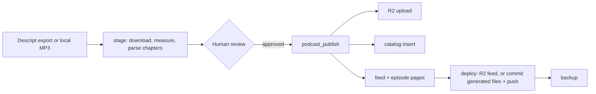

# podcast_server

A self-hosted podcast publishing engine that AI agents operate through MCP (Model Context Protocol) tools instead of a web dashboard. Audio lives in your own Cloudflare R2 bucket, the catalog is a SQLite file you can inspect, and the RSS feed is served from your own domain. An agent does the publishing steps; a human approves each episode before it goes live.

**New here? Start with [`ADOPTING.md`](./ADOPTING.md)**, a step-by-step guide to running your own show, including migrating from another host without losing subscribers.

---

## Features

- **Feed:** RSS 2.0 + iTunes + Podcasting 2.0 (`<podcast:locked>`, `<podcast:guid>`), exact enclosure byte lengths, Markdown show notes rendered to `content:encoded`, optional OP3 analytics.
- **Two site modes:** `none` serves the feed from your R2 domain, with no website needed. `astro` writes one Markdown page per episode into your site repo and pushes only those files.
- **Migration:** a GUID-preserving importer for any host's RSS feed, with audio mirrored into R2.
- **Agent surface:** 17 MCP tools covering staging (including Descript), publishing, blog posts, social drafts and X posts, media uploads, YouTube, and audience metrics.
- **Audience metrics:** pluggable collectors (OP3 downloads, Cloudflare audio traffic, X and YouTube engagement for the show's own posts and videos, or your own) feed a local SQLite store, an offline HTML dashboard, and MCP tools agents can query.
- **Safety:** see the list below; checks run before any upload.
- **Backups:** incremental, to a private Hugging Face dataset.

## How Publishing Works



---

## What You Need

`podcast_server` doesn't host anything itself. It drives services you own. The pieces below are what a show needs; each links to its own setup docs, which are the authority for that service (and several have their own MCP server your agent can use for setup).

**Required**

| Piece | What it's for | Get set up |
| :--- | :--- | :--- |
| A domain | Your audio URLs (e.g. `audio.myshow.com`) and feed live on it, so you can change hosts without losing subscribers | Any registrar, e.g. [Cloudflare Registrar](https://www.cloudflare.com/products/registrar/). The domain's DNS must be on Cloudflare for the R2 custom domain ([full setup](https://developers.cloudflare.com/dns/zone-setups/full-setup/)). |
| Cloudflare R2 bucket | Stores the MP3s and serves them (no egress fees, range requests) | [R2 docs](https://developers.cloudflare.com/r2/): create a bucket, an API token with Object Read & Write, and a [custom domain](https://developers.cloudflare.com/r2/buckets/public-buckets/) on it. Cloudflare's [MCP servers](https://developers.cloudflare.com/agents/model-context-protocol/mcp-servers-for-cloudflare/) can help an agent do this. |
| A home for the RSS feed | The URL podcast apps subscribe to | Either nothing extra (`SITE_MODE=none` uploads the feed to your R2 domain) or a git-deployed static site (`SITE_MODE=astro`, e.g. [Astro](https://docs.astro.build) on [Netlify](https://docs.netlify.com)), which also gets one page per episode. |
| Cover art | Required by every directory | Square JPEG/PNG, 1400–3000 px, at a public URL. See [Apple's requirements](https://podcasters.apple.com/support/823-podcast-requirements). |
| Directory listings | How listeners find the show | Submit your feed URL once to [Apple Podcasts Connect](https://podcastsconnect.apple.com), [Spotify for Creators](https://creators.spotify.com), and [Podcast Index](https://podcastindex.org/add) (which feeds many smaller apps). |
| An MCP client and Python tooling | The agent that runs the tools, and the engine's runtime | Any [MCP client](https://modelcontextprotocol.io/clients) (Claude Desktop, Cursor, ...), plus [uv](https://docs.astral.sh/uv/). |

**Optional**

| Piece | Unlocks | Get set up |
| :--- | :--- | :--- |
| [Descript](https://www.descript.com) | Staging episodes straight from a Descript export (chapters from markers) | Export the transcript as Markdown; see ADOPTING. |
| X developer app + [xurl](https://github.com/xdevplatform/xurl) | `podcast_post_to_x` and X metrics for those posts | An app in the [X developer portal](https://developer.x.com) (read and write, OAuth 2.0); X bills API use. Steps in ADOPTING. |
| YouTube Data + Analytics APIs | `podcast_publish_to_youtube`, and YouTube metrics for the show's videos | A Google Cloud OAuth client ([Data API](https://developers.google.com/youtube/v3), [Analytics API](https://developers.google.com/youtube/analytics)). |
| [OP3](https://op3.dev) | Free, open download analytics (stats are public) | `USE_OP3_PREFIX=true` and a free API key. |
| Cloudflare analytics token | Audio-traffic metrics from the edge | A token with Zone → Analytics → Read (listed as Domain → Analytics → Read in newer dashboards). |
| Hugging Face account | Private, incremental backups of audio and catalog | A private dataset; Hugging Face also offers an [MCP server](https://huggingface.co/settings/mcp). |

[`ADOPTING.md`](./ADOPTING.md) walks through each step in order with the exact settings.

## Quick Start

```bash
# needs uv: https://docs.astral.sh/uv/  (curl -LsSf https://astral.sh/uv/install.sh | sh)
git clone <this repo> podcast_server && cd podcast_server
uv sync                                       # creates .venv with Python 3.11+ and locked dependencies
cp .env.example .env && chmod 600 .env       # fill in your show's values
uv run python -m core.doctor  # verifies R2, domain, site, artwork, feed
uv run python -m unittest discover -s tests
```

[`ADOPTING.md`](./ADOPTING.md) covers Cloudflare setup, configuration, first publish, and migration in detail.

### Configuration

Every setting is documented inline in [`.env.example`](./.env.example).

| Group | Variables |
| :--- | :--- |
| Show identity (required) | `PODCAST_TITLE`, `PODCAST_DESCRIPTION`, `PODCAST_AUTHOR`, `PODCAST_OWNER_EMAIL`, `PODCAST_LINK`, `PODCAST_FEED_URL`, `PODCAST_IMAGE_URL`, `EPISODE_GUID_PREFIX` |
| Storage (required) | `R2_ACCOUNT_ID`, `R2_ACCESS_KEY_ID`, `R2_SECRET_ACCESS_KEY`, `R2_BUCKET_NAME`, `R2_PUBLIC_DOMAIN`, optional `USE_OP3_PREFIX` |
| Website | `SITE_MODE` (`none`/`astro`), `WEBSITE_PATH`, `WEBSITE_RSS_FILE`, `WEBSITE_EPISODES_DIR`, `WEBSITE_BLOG_DIR`, `WEBSITE_BRANCH`, `FEED_OBJECT_KEY` |
| Show data | `DATA_DIR` (catalog, transcripts, templates, playbook, backups) |
| Integrations (optional) | `DESCRIPT_API_BEARER`, `YOUTUBE_TOKEN_PATH`, `HF_BACKUP_REPO`, `THUMBNAIL_STYLE`, `DEFAULT_TAGS`, `PODCAST_GUID` |
| X posting (optional) | `X_USERNAME`, `XURL_APP`, `XURL_PATH` (tokens stay in xurl's own auth file) |
| Metrics (optional) | `OP3_API_TOKEN`, `CLOUDFLARE_API_TOKEN` + `CLOUDFLARE_ZONE_ID`, X via the posting setup (or `X_BEARER_TOKEN`), `X_LOOKBACK_DAYS`, YouTube via `YOUTUBE_TOKEN_PATH` (+ `$DATA_DIR/youtube_videos.json`), `METRICS_SOURCES`, `METRICS_EXTRA_COLLECTORS`, `METRICS_BACKFILL_DAYS` |

There are no show values in the code: startup fails and lists any required variable that's missing. `PODCAST_SERVER_ENV_FILE=/path/to/show.env` selects a different config (one per show).

### Your Show's Private Data

Keep `DATA_DIR` outside this checkout, ideally in its own private repo. [`examples/show-data/`](./examples/show-data/) is a template to copy:

```
my-show-data/
├── PLAYBOOK.md               # your editorial voice, title rules, workflows (agents read this first)
├── DEPLOYMENT.md             # your infrastructure record: DNS, R2, website, backups, credential locations
├── templates/                # social_long.txt, social_short.txt
├── excluded_episodes.json    # episodes that must never be (re)published
├── transcripts/              # <slug>.txt
├── catalog.db                # created on first run; don't commit it (back it up instead)
├── metrics.db                # collected audience metrics; safe to delete and re-collect
└── metrics/dashboard.html    # written by `python -m metrics.report`
```

### Register the MCP Server

```json
{
  "mcpServers": {
    "podcast_server": { "command": "/absolute/path/to/podcast_server/bin/run-mcp.sh" }
  }
}
```

Agents should read [`AGENTS.md`](./AGENTS.md) and then your `PLAYBOOK.md`.

---

## MCP Tools

| Area | Tools |
| :--- | :--- |
| Catalog | `podcast_status`, `podcast_list_episodes`, `podcast_get_episode`, `podcast_inspect` |
| Publishing | `podcast_stage_from_descript`, `podcast_publish`, `podcast_rebuild_feed` |
| Content | `podcast_create_blog`, `podcast_draft_social`, `podcast_stage_thumbnail` |
| Distribution | `podcast_upload_media_asset`, `podcast_publish_to_youtube`, `podcast_post_to_x` |
| Metrics | `podcast_metrics_collect`, `podcast_metrics_summary`, `podcast_episode_metrics`, `podcast_metrics_report` |

## Common Commands

| Task | Command |
| :--- | :--- |
| Check the setup | `uv run python -m core.doctor` |
| Rebuild feed (+ pages), no deploy | `uv run python -m core.site` |
| Import a back catalog | `uv run python -m importers.rss <feed-url> --mirror` |
| Back up | `uv run python scripts/backup_to_hf.py` |
| Collect metrics + write the dashboard | `uv run python -m metrics.collect --report` (schedule `bin/collect-metrics.sh` daily) |
| Run tests | `uv run python -m unittest discover -s tests` |

## Safety Guarantees

The engine refuses to:
- **Reuse a slug or regenerate a GUID**, which would show duplicate episodes on every subscriber's device.
- **Re-add excluded episodes**: a database trigger blocks them, even for raw SQL.
- **Publish unrelated website work**: deploys commit only generated files, only from `WEBSITE_BRANCH`.
- **Publish broken downloads**: episodes whose audio isn't in R2 are left out of the feed and pages.
- **Upload arbitrary files** to the public bucket, or overwrite existing (immutably cached) objects.
- **Leak credentials**: downloads are https-only, and the Descript token is sent only to Descript hosts.

## Troubleshooting

| Symptom | Cause and fix |
| :--- | :--- |
| `git_deploy.status: skipped` | The site repo isn't on `WEBSITE_BRANCH`. Switch branches and run `deploy_site(...)` (see `AGENTS.md` §5). |
| `git_deploy.status: failed`, "could not read Username" | Git has no usable credentials. On headless Linux, keyring helpers (libsecret) can't unlock; use `credential.helper store` or a fine-grained token. |
| Rewritten show notes don't reach podcast apps | Update `content_markdown` (a trigger clears stale imported HTML), then rebuild and deploy. |
| Backup re-downloads audio every run | Catalog byte lengths don't match R2; sizes must come from the stored object (the importer's `--mirror` records them). |
| `core.doctor`: domain resolves publicly but not locally | Your resolver cached an old "no such host" answer; it clears on its own. |

---

## Project Structure

```
podcast_server/
├── core/                  # config, catalog (db), R2 storage, feed XML, site output + deploy, doctor, helpers
├── mcp_server/server.py   # the 17 MCP tools
├── importers/             # rss.py (any host, GUID-preserving), descript.py (staging)
├── exporters/             # Astro pages, blog posts, social drafts, X posting, YouTube upload
├── metrics/               # collectors (OP3, Cloudflare, X, plugins), store, analysis, dashboard
├── scripts/backup_to_hf.py
├── examples/show-data/    # template for your private DATA_DIR
├── tests/
├── pyproject.toml / uv.lock  # uv project: dependencies + lockfile
├── ADOPTING.md            # run your own show
├── AGENTS.md              # operating guide for agents
└── PLAN.md                # architecture and roadmap
```

## License

[Business Source License 1.1](./LICENSE): free for personal, open-source, and internal business use; not for offering a competing commercial hosted podcast service. Converts to Apache 2.0 on October 26, 2029.
