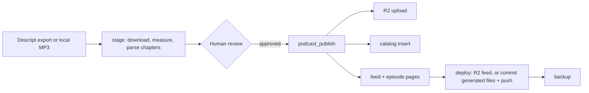

# podcast_server

A self-hosted podcast publishing engine that AI agents operate through MCP (Model Context Protocol) tools instead of a web dashboard. Audio lives in your own Cloudflare R2 bucket, the catalog is a SQLite file you can inspect, and the RSS feed is served from your own domain. An agent does the publishing steps; a human approves each episode before it goes live.

**New here? Start with [`ADOPTING.md`](./ADOPTING.md)**, a step-by-step guide to running your own show, including migrating from another host without losing subscribers.

---

## Features

- **Feed:** RSS 2.0 + iTunes + Podcasting 2.0 (`<podcast:locked>`), exact enclosure byte lengths, Markdown show notes rendered to `content:encoded`, optional OP3 analytics.
- **Two site modes:** `none` serves the feed from your R2 domain, with no website needed. `astro` writes one Markdown page per episode into your site repo and pushes only those files.
- **Migration:** a GUID-preserving importer for any host's RSS feed, with audio mirrored into R2.
- **Agent surface:** 12 MCP tools covering staging (including Descript), publishing, blog posts, social drafts, media uploads, and YouTube.
- **Safety:** see the list below; checks run before any upload.
- **Backups:** incremental, to a private Hugging Face dataset.

## How Publishing Works



---

## Quick Start

```bash
git clone <this repo> podcast_server && cd podcast_server
python3 -m venv .venv && .venv/bin/pip install -r requirements.txt   # Python 3.11+
cp .env.example .env && chmod 600 .env       # fill in your show's values
PYTHONPATH=. .venv/bin/python -m core.doctor  # verifies R2, domain, site, artwork, feed
PYTHONPATH=. .venv/bin/python -m unittest discover -s tests
```

[`ADOPTING.md`](./ADOPTING.md) covers Cloudflare setup, configuration, first publish, and migration in detail.

### Configuration

Every setting is documented inline in [`.env.example`](./.env.example).

| Group | Variables |
| :--- | :--- |
| Show identity (required) | `PODCAST_TITLE`, `PODCAST_DESCRIPTION`, `PODCAST_AUTHOR`, `PODCAST_OWNER_EMAIL`, `PODCAST_LINK`, `PODCAST_FEED_URL`, `PODCAST_IMAGE_URL`, `EPISODE_GUID_PREFIX` |
| Storage (required) | `R2_ACCOUNT_ID`, `R2_ACCESS_KEY_ID`, `R2_SECRET_ACCESS_KEY`, `R2_BUCKET_NAME`, `R2_PUBLIC_DOMAIN`, optional `USE_OP3_PREFIX` |
| Website | `SITE_MODE` (`none`/`astro`), `WEBSITE_PATH`, `WEBSITE_RSS_FILE`, `WEBSITE_EPISODES_DIR`, `WEBSITE_BLOG_DIR`, `WEBSITE_BRANCH`, `FEED_OBJECT_KEY` |
| Show data | `DATA_DIR` (catalog, transcripts, templates, playbook, backups) |
| Integrations (optional) | `DESCRIPT_API_BEARER`, `YOUTUBE_TOKEN_PATH`, `HF_BACKUP_REPO`, `THUMBNAIL_STYLE`, `DEFAULT_TAGS` |

There are no show values in the code: startup fails and lists any required variable that's missing. `PODCAST_SERVER_ENV_FILE=/path/to/show.env` selects a different config (one per show).

### Your Show's Private Data

Keep `DATA_DIR` outside this checkout, ideally in its own private repo. [`examples/show-data/`](./examples/show-data/) is a template to copy:

```
my-show-data/
├── PLAYBOOK.md               # your editorial voice, title rules, workflows (agents read this first)
├── templates/                # social_long.txt, social_short.txt
├── excluded_episodes.json    # episodes that must never be (re)published
├── transcripts/              # <slug>.txt
└── catalog.db                # created on first run; don't commit it (back it up instead)
```

### Register the MCP Server

```json
{
  "mcpServers": {
    "podcast_server": { "command": "/absolute/path/to/podcast_server/bin/run-mcp.sh" }
  }
}
```

Agents should read [`AGENTS.md`](./AGENTS.md) and then your `PLAYBOOK.md`.

---

## MCP Tools

| Area | Tools |
| :--- | :--- |
| Catalog | `podcast_status`, `podcast_list_episodes`, `podcast_get_episode`, `podcast_inspect` |
| Publishing | `podcast_stage_from_descript`, `podcast_publish`, `podcast_rebuild_feed` |
| Content | `podcast_create_blog`, `podcast_draft_social`, `podcast_stage_thumbnail` |
| Distribution | `podcast_upload_media_asset`, `podcast_publish_to_youtube` |

## Common Commands

| Task | Command |
| :--- | :--- |
| Check the setup | `PYTHONPATH=. .venv/bin/python -m core.doctor` |
| Rebuild feed (+ pages), no deploy | `PYTHONPATH=. .venv/bin/python -m core.site` |
| Import a back catalog | `PYTHONPATH=. .venv/bin/python -m importers.rss <feed-url> --mirror` |
| Back up | `PYTHONPATH=. .venv/bin/python scripts/backup_to_hf.py` |
| Run tests | `PYTHONPATH=. .venv/bin/python -m unittest discover -s tests` |

## Safety Guarantees

The engine refuses to:
- **Reuse a slug or regenerate a GUID**, which would show duplicate episodes on every subscriber's device.
- **Re-add excluded episodes**: a database trigger blocks them, even for raw SQL.
- **Publish unrelated website work**: deploys commit only generated files, only from `WEBSITE_BRANCH`.
- **Publish broken downloads**: episodes whose audio isn't in R2 are left out of the feed and pages.
- **Upload arbitrary files** to the public bucket, or overwrite existing (immutably cached) objects.
- **Leak credentials**: downloads are https-only, and the Descript token is sent only to Descript hosts.

## Troubleshooting

| Symptom | Cause and fix |
| :--- | :--- |
| `git_deploy.status: skipped` | The site repo isn't on `WEBSITE_BRANCH`. Switch branches and run `deploy_site(...)` (see `AGENTS.md` §5). |
| `git_deploy.status: failed`, "could not read Username" | Git has no usable credentials. On headless Linux, keyring helpers (libsecret) can't unlock; use `credential.helper store` or a fine-grained token. |
| Rewritten show notes don't reach podcast apps | Update `content_markdown` (a trigger clears stale imported HTML), then rebuild and deploy. |
| Backup re-downloads audio every run | Catalog byte lengths don't match R2; sizes must come from the stored object (the importer's `--mirror` records them). |
| `core.doctor`: domain resolves publicly but not locally | Your resolver cached an old "no such host" answer; it clears on its own. |

---

## Project Structure

```
podcast_server/
├── core/                  # config, catalog (db), R2 storage, feed XML, site output + deploy, doctor, helpers
├── mcp_server/server.py   # the 12 MCP tools
├── importers/             # rss.py (any host, GUID-preserving), descript.py (staging)
├── exporters/             # Astro pages, blog posts, social drafts, YouTube upload
├── scripts/backup_to_hf.py
├── examples/show-data/    # template for your private DATA_DIR
├── tests/
├── ADOPTING.md            # run your own show
├── AGENTS.md              # operating guide for agents
└── PLAN.md                # architecture and roadmap
```

## License

[Business Source License 1.1](./LICENSE): free for personal, open-source, and internal business use; not for offering a competing commercial hosted podcast service. Converts to Apache 2.0 on October 26, 2029.
